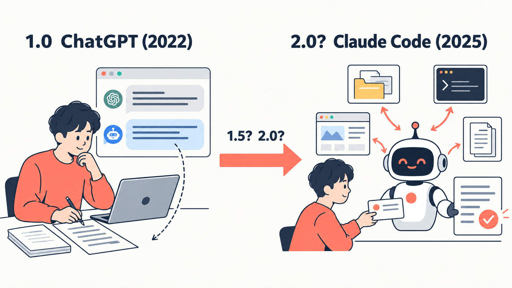
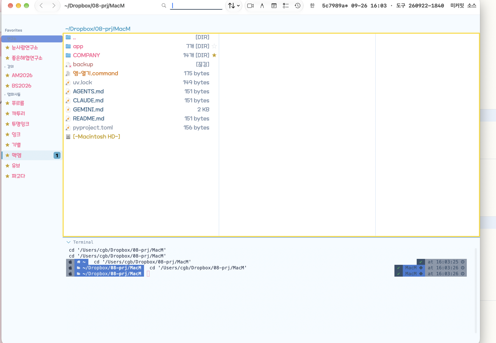
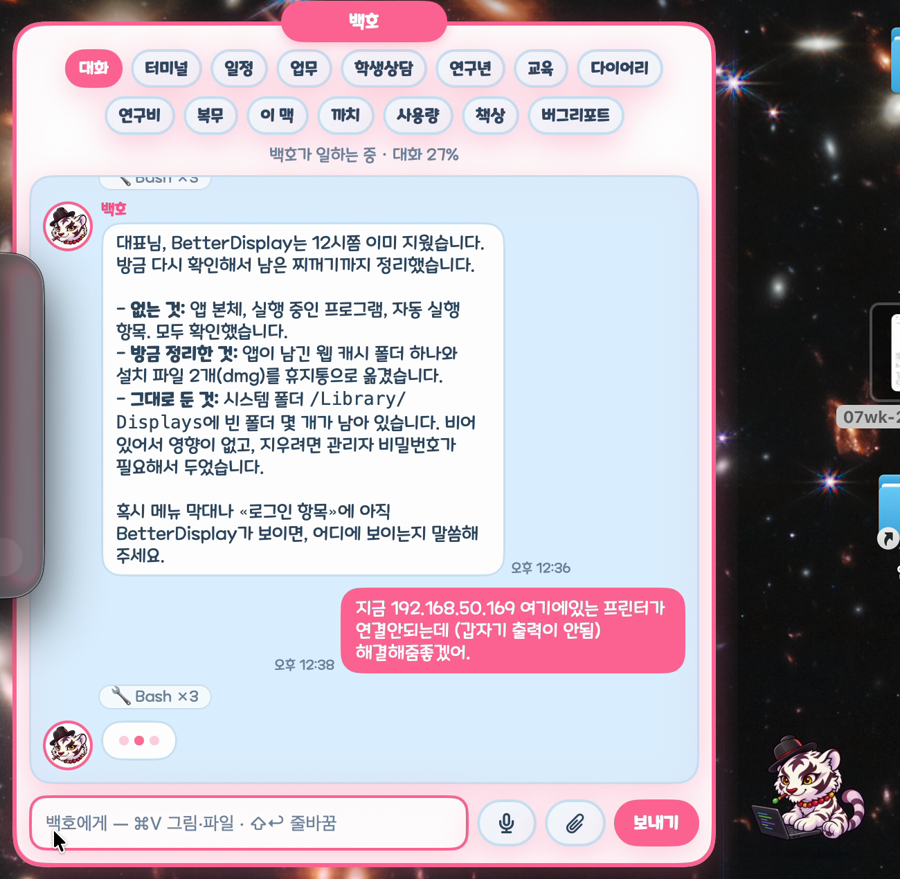
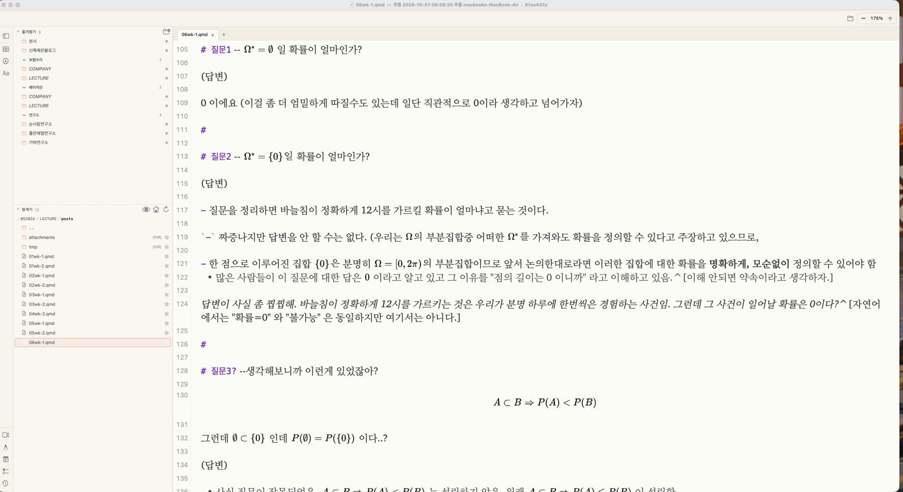
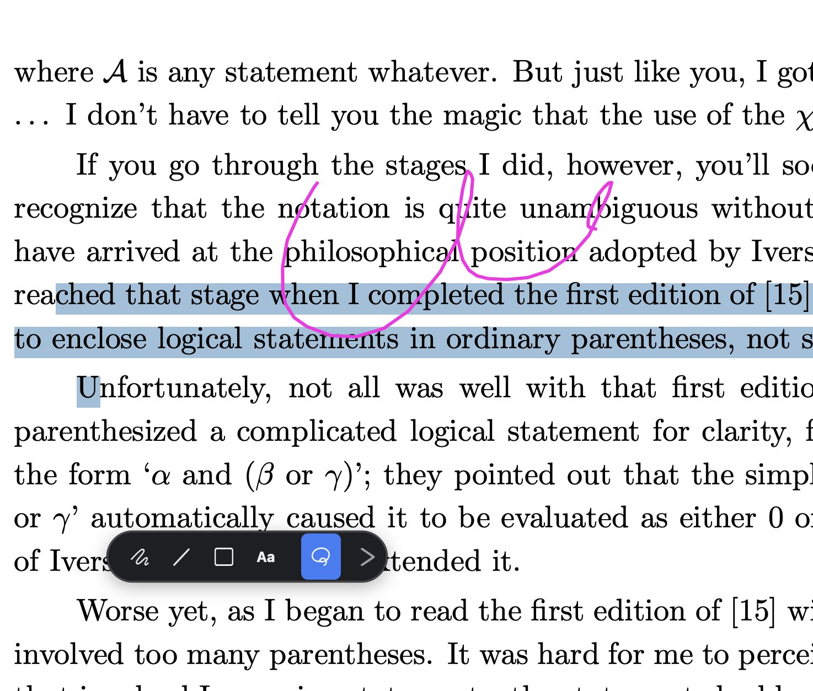

### 목차

::: {.toc-big}

1. 들어가며
2. 사용법
    - 튜토리얼
    - 에이전트에게 일을 잘 시키는 법
3. 활용사례
    - 사례 1: 교육 · 연구
    - 사례 2: 잡무 처리
    - 사례 3: 앱 만들고 활용
4. 맺음말

:::

# 들어가며

---

### ChatGPT 에서 Claude Code 로

{width=85%}

# 튜토리얼

---

### 예제1: 폴더 만들기 · 지우기 · 파일 정리하기

- 예제 파일: [Downloads.zip](예제파일/Downloads.zip) · [추가그림.zip](예제파일/추가그림.zip)

---

### 예제2: 사진 파일 정리하기

---

### 예제3: CSV 파일 정리하고 시각화하기

---

### 예제4: 바탕화면에 test 폴더를 만드는 여러 가지 방법

::: {.panel-tabset}

#### 방법 ①

<video class="lecvid" controls preload="metadata" src="../../%EC%97%90%EC%9D%B4%EC%A0%84%ED%8B%B1%EC%BD%94%EB%94%A9%EC%B4%AC%EC%98%81%EC%98%81%EC%83%81/1-4%20%EC%9B%B9%C2%B7%EB%A9%94%EC%8B%A0%EC%A0%80%C2%B7%ED%8E%AB%C2%B7%EC%A0%84%ED%99%94%EB%A1%9C%20%EC%93%B0%EA%B8%B0/1-4_1_%EC%86%90%EC%9C%BC%EB%A1%9C_Finder%EC%83%88%ED%8F%B4%EB%8D%94_2%EB%B0%B0%EC%86%8D.mp4"></video>

#### 방법 ②

<video class="lecvid" controls preload="metadata" src="../../%EC%97%90%EC%9D%B4%EC%A0%84%ED%8B%B1%EC%BD%94%EB%94%A9%EC%B4%AC%EC%98%81%EC%98%81%EC%83%81/1-4%20%EC%9B%B9%C2%B7%EB%A9%94%EC%8B%A0%EC%A0%80%C2%B7%ED%8E%AB%C2%B7%EC%A0%84%ED%99%94%EB%A1%9C%20%EC%93%B0%EA%B8%B0/1-4_2_%ED%84%B0%EB%AF%B8%EB%84%90%EB%AA%85%EB%A0%B9_mkdir_2%EB%B0%B0%EC%86%8D.mp4"></video>

#### 방법 ③

<video class="lecvid" controls preload="metadata" src="../../%EC%97%90%EC%9D%B4%EC%A0%84%ED%8B%B1%EC%BD%94%EB%94%A9%EC%B4%AC%EC%98%81%EC%98%81%EC%83%81/1-4%20%EC%9B%B9%C2%B7%EB%A9%94%EC%8B%A0%EC%A0%80%C2%B7%ED%8E%AB%C2%B7%EC%A0%84%ED%99%94%EB%A1%9C%20%EC%93%B0%EA%B8%B0/1-4_3_%ED%84%B0%EB%AF%B8%EB%84%90%EC%97%90%EC%84%9C_ClaudeCode%EC%97%90%EA%B2%8C_2%EB%B0%B0%EC%86%8D.mp4"></video>

#### 방법 ④

<video class="lecvid" controls preload="metadata" src="../../%EC%97%90%EC%9D%B4%EC%A0%84%ED%8B%B1%EC%BD%94%EB%94%A9%EC%B4%AC%EC%98%81%EC%98%81%EC%83%81/1-4%20%EC%9B%B9%C2%B7%EB%A9%94%EC%8B%A0%EC%A0%80%C2%B7%ED%8E%AB%C2%B7%EC%A0%84%ED%99%94%EB%A1%9C%20%EC%93%B0%EA%B8%B0/1-4_4_%EC%9B%B9%EC%9C%BC%EB%A1%9C_ClaudeCode%EC%9B%90%EA%B2%A9%EC%A1%B0%EC%A2%85_2%EB%B0%B0%EC%86%8D.mp4"></video>

#### 방법 ⑤

<video class="lecvid" controls preload="metadata" src="../../%EC%97%90%EC%9D%B4%EC%A0%84%ED%8B%B1%EC%BD%94%EB%94%A9%EC%B4%AC%EC%98%81%EC%98%81%EC%83%81/1-4%20%EC%9B%B9%C2%B7%EB%A9%94%EC%8B%A0%EC%A0%80%C2%B7%ED%8E%AB%C2%B7%EC%A0%84%ED%99%94%EB%A1%9C%20%EC%93%B0%EA%B8%B0/1-4_5_%EB%A9%94%EC%8B%A0%EC%A0%80%EB%A1%9C_%EA%B9%8C%ED%88%AC%EB%A6%AC%EC%9B%B9_%EC%97%84%EB%A7%88%EA%B9%8C%ED%88%AC%EB%A6%AC_2%EB%B0%B0%EC%86%8D.mp4"></video>

#### 방법 ⑥

<video class="lecvid" controls preload="metadata" src="../../%EC%97%90%EC%9D%B4%EC%A0%84%ED%8B%B1%EC%BD%94%EB%94%A9%EC%B4%AC%EC%98%81%EC%98%81%EC%83%81/1-4%20%EC%9B%B9%C2%B7%EB%A9%94%EC%8B%A0%EC%A0%80%C2%B7%ED%8E%AB%C2%B7%EC%A0%84%ED%99%94%EB%A1%9C%20%EC%93%B0%EA%B8%B0/1-4_6_%EB%A9%94%EC%8B%A0%EC%A0%80_%ED%8C%A8%EC%85%98%EC%83%B5_%EC%97%84%EB%A7%88%EA%B9%8C%ED%88%AC%EB%A6%AC%ED%8E%AB%EC%9C%BC%EB%A1%9C%EC%A7%80%EC%9A%B0%EA%B8%B0_2%EB%B0%B0%EC%86%8D.mp4"></video>

#### 방법 ⑦

<video class="lecvid" controls preload="metadata" src="../../%EC%97%90%EC%9D%B4%EC%A0%84%ED%8B%B1%EC%BD%94%EB%94%A9%EC%B4%AC%EC%98%81%EC%98%81%EC%83%81/1-4%20%EC%9B%B9%C2%B7%EB%A9%94%EC%8B%A0%EC%A0%80%C2%B7%ED%8E%AB%C2%B7%EC%A0%84%ED%99%94%EB%A1%9C%20%EC%93%B0%EA%B8%B0/1-4_7_%ED%8E%AB%EC%9C%BC%EB%A1%9C_%EB%B0%B1%ED%98%B8_2%EB%B0%B0%EC%86%8D.mp4"></video>

#### 방법 ⑧

<video class="lecvid" controls preload="metadata" src="../../%EC%97%90%EC%9D%B4%EC%A0%84%ED%8B%B1%EC%BD%94%EB%94%A9%EC%B4%AC%EC%98%81%EC%98%81%EC%83%81/1-4%20%EC%9B%B9%C2%B7%EB%A9%94%EC%8B%A0%EC%A0%80%C2%B7%ED%8E%AB%C2%B7%EC%A0%84%ED%99%94%EB%A1%9C%20%EC%93%B0%EA%B8%B0/1-4_9_%EC%A0%84%ED%99%94%EB%A1%9C_%EC%93%B0%EA%B8%B0.mp4"></video>

#### 보너스 영상

<video class="lecvid" controls preload="metadata" src="../../%EC%97%90%EC%9D%B4%EC%A0%84%ED%8B%B1%EC%BD%94%EB%94%A9%EC%B4%AC%EC%98%81%EC%98%81%EC%83%81/1-4%20%EC%9B%B9%C2%B7%EB%A9%94%EC%8B%A0%EC%A0%80%C2%B7%ED%8E%AB%C2%B7%EC%A0%84%ED%99%94%EB%A1%9C%20%EC%93%B0%EA%B8%B0/1-4_8_%ED%8E%AB%EC%9C%BC%EB%A1%9C_%EC%93%B0%EA%B8%B0_%EB%B0%B1%ED%98%B8%EC%97%90%EA%B2%8C_%EC%98%81%EC%83%81%EC%A0%95%EB%A6%AC_2%EB%B0%B0%EC%86%8D.mp4"></video>

:::

# 에이전트에게 일을 잘 시키는 법

---

### 1. 기억하게 하라

::: {.panel-tabset}

#### 영상 ①

<video class="lecvid" controls preload="metadata" src="../../%EC%97%90%EC%9D%B4%EC%A0%84%ED%8B%B1%EC%BD%94%EB%94%A9%EC%B4%AC%EC%98%81%EC%98%81%EC%83%81/2-1%20%EC%A7%80%EB%82%9C%20%EC%84%B8%EC%85%98%EC%9D%84%20%EA%B8%B0%EC%96%B5%ED%95%98%EB%8A%94%20AI%EF%BC%9A%20%EC%82%AC%EC%A7%84%20%EC%9D%B4%EB%A6%84%20%EC%A7%93%EA%B8%B0/2-1_1%EB%8B%A8%EA%B3%84_%EA%B7%B8%EB%83%A5_%ED%95%98%EA%B8%B0.mp4"></video>

#### 영상 ②

<video class="lecvid" controls preload="metadata" src="../../%EC%97%90%EC%9D%B4%EC%A0%84%ED%8B%B1%EC%BD%94%EB%94%A9%EC%B4%AC%EC%98%81%EC%98%81%EC%83%81/2-1%20%EC%A7%80%EB%82%9C%20%EC%84%B8%EC%85%98%EC%9D%84%20%EA%B8%B0%EC%96%B5%ED%95%98%EB%8A%94%20AI%EF%BC%9A%20%EC%82%AC%EC%A7%84%20%EC%9D%B4%EB%A6%84%20%EC%A7%93%EA%B8%B0/2-1_2%EB%8B%A8%EA%B3%84_%EA%B8%B0%EB%A1%9D_%EB%B0%8F_%EA%B8%B0%EB%A1%9D_%EC%9D%BD%EA%B8%B0_%EC%A7%80%EC%8B%9C.mp4"></video>

#### 영상 ③

<video class="lecvid" controls preload="metadata" src="../../%EC%97%90%EC%9D%B4%EC%A0%84%ED%8B%B1%EC%BD%94%EB%94%A9%EC%B4%AC%EC%98%81%EC%98%81%EC%83%81/2-1%20%EC%A7%80%EB%82%9C%20%EC%84%B8%EC%85%98%EC%9D%84%20%EA%B8%B0%EC%96%B5%ED%95%98%EB%8A%94%20AI%EF%BC%9A%20%EC%82%AC%EC%A7%84%20%EC%9D%B4%EB%A6%84%20%EC%A7%93%EA%B8%B0/2-1_3%EB%8B%A8%EA%B3%84_%EC%B6%9C%ED%87%B4%EA%B7%BC_%EB%AC%B8%EC%84%9C.mp4"></video>

#### 영상 ④

<video class="lecvid" controls preload="metadata" src="../../%EC%97%90%EC%9D%B4%EC%A0%84%ED%8B%B1%EC%BD%94%EB%94%A9%EC%B4%AC%EC%98%81%EC%98%81%EC%83%81/2-1%20%EC%A7%80%EB%82%9C%20%EC%84%B8%EC%85%98%EC%9D%84%20%EA%B8%B0%EC%96%B5%ED%95%98%EB%8A%94%20AI%EF%BC%9A%20%EC%82%AC%EC%A7%84%20%EC%9D%B4%EB%A6%84%20%EC%A7%93%EA%B8%B0/2-1_4%EB%8B%A8%EA%B3%84_%EC%B6%9C%ED%87%B4%EA%B7%BC_%EB%AC%B8%EC%84%9C_%EB%B0%8F_%EB%85%B8%ED%95%98%EC%9A%B0.mp4"></video>

:::

---

### 2. 공간을 만들어 줘라

::: {.panel-tabset}

#### 영상

<video class="lecvid" controls preload="metadata" src="../../%EC%97%90%EC%9D%B4%EC%A0%84%ED%8B%B1%EC%BD%94%EB%94%A9%EC%B4%AC%EC%98%81%EC%98%81%EC%83%81/2-2%20%EA%B3%B5%EA%B0%84%EB%A7%8C%EB%93%A4%EC%96%B4%EC%A3%BC%EA%B8%B0_%EB%8B%A4%EC%98%A8/%EC%97%90%EC%9D%B4%EC%A0%84%ED%8A%B8%EC%97%90%EA%B2%8C_%EC%B1%85%EC%83%81_%EB%A7%8C%EB%93%A4%EC%96%B4%EC%A3%BC%EA%B8%B0.mp4"></video>

#### 예시

눈사람연구소 블로그팀 소미의 자리 (실제 폴더 · 10-26) — 코드 · 코드 결과 · 블로그 글이 한 책상에

```
소미(블로그팀)/
├── 우편함/        받음 1 · 읽음 251 · 보냄 229
├── 퇴근일지/      56개 — 출근할 때 지난 것을 읽는다
└── 책상/          파일 1,585개
    ├── 개인업무일지.md · 개인메모장.md · 대표지시사항.md
    ├── codes/ (64)          260915_소미_432런_Tier판정.py
    │                        260915_소미_(병렬)27예제x16시드_AAA_432런.sh  …
    ├── results/             260901_소미_24예제_HST_AAA_앙상블_단일.py · figures/ (13)  …
    ├── blog/                260528_연구_눈사람연구소_AAAvsBAB.qmd  …
    ├── 보고문서/ (48)   노하우/ (4)   반성문/ (1)   교육판/ (3)
    └── archive/ (29)   _backup/ (135)   잉크판독 · 죽은참조검사 …
```

:::

---

### 3. 에이전트끼리 소통하게 하라

::: {.panel-tabset}

#### 영상 ①

<video class="lecvid" controls preload="metadata" src="../../%EC%97%90%EC%9D%B4%EC%A0%84%ED%8B%B1%EC%BD%94%EB%94%A9%EC%B4%AC%EC%98%81%EC%98%81%EC%83%81/2-3%20%EC%97%AC%EB%9F%AC%EC%97%90%EC%9D%B4%EC%A0%84%ED%8A%B8%ED%99%9C%EC%9A%A9_%EB%8B%A4%EC%98%A8%C2%B7%EA%B0%80%EC%98%A8/2-3_TAKE1_%EC%A7%80%EB%82%9C_%EC%9D%B4%EC%95%BC%EA%B8%B0.mp4"></video>

#### 영상 ②

<video class="lecvid" controls preload="metadata" src="../../%EC%97%90%EC%9D%B4%EC%A0%84%ED%8B%B1%EC%BD%94%EB%94%A9%EC%B4%AC%EC%98%81%EC%98%81%EC%83%81/2-3%20%EC%97%AC%EB%9F%AC%EC%97%90%EC%9D%B4%EC%A0%84%ED%8A%B8%ED%99%9C%EC%9A%A9_%EB%8B%A4%EC%98%A8%C2%B7%EA%B0%80%EC%98%A8/2-3_TAKE2_%EC%9A%B0%ED%8E%B8%ED%95%A8_%EB%A7%8C%EB%93%A4%EA%B8%B0_%EA%B0%80%EC%98%A8_%EC%B6%9C%EA%B7%BC.mp4"></video>

#### 영상 ③

<video class="lecvid" controls preload="metadata" src="../../%EC%97%90%EC%9D%B4%EC%A0%84%ED%8B%B1%EC%BD%94%EB%94%A9%EC%B4%AC%EC%98%81%EC%98%81%EC%83%81/2-3%20%EC%97%AC%EB%9F%AC%EC%97%90%EC%9D%B4%EC%A0%84%ED%8A%B8%ED%99%9C%EC%9A%A9_%EB%8B%A4%EC%98%A8%C2%B7%EA%B0%80%EC%98%A8/2-3_TAKE3_%EB%82%98%EB%88%A0_%EB%A7%A1%EA%B3%A0_%EB%8F%99%EC%8B%9C%EC%97%90_%EC%9D%BC%ED%95%98%EA%B8%B0.mp4"></video>

:::

---

### 4. 서버에서 일하게 하라

#### 서버를 써야 하는 이유

1. 지속성: 노트북을 덮어도 에이전트는 서버에서 계속 일한다.
2. 성능: 노트북에서 에이전트가 일하면 노트북이 느려진다.

---

### 4. 서버에서 일하게 하라

#### 어려웠던 점

1. 여러 서버 · 여러 에이전트 다루기
    - 한 에이전트가 여러 서버에 동시에 접속해 일을 시킬 수 있어야 한다.
    - 여러 서버에 흩어진 에이전트들을 한눈에 파악하고 자유롭게 다룰 수 있어야 한다.
    - 비어 있는 자원을 실시간으로 파악해 작업을 바로 나눠 줘야 한다.
2. 에이전트 사이의 파일 공유 · 소통
    - 파일 · 메시지 등을 자유롭게 주고받으며 소통할 수 있어야 한다.
    - 서로 다른 서버, 서로 다른 모델 사이의 소통도 자유로워야 한다.
3. 파이썬 환경 설정
    - 서버마다 깔린 파이썬 버전이 다르고, 아나콘다 · venv · 시스템 파이썬이 뒤섞여 있다.
    - 서버마다 가상환경을 철저히 관리해, 여러 서버를 한 서버처럼 쓸 수 있어야 한다.
4. 작업 연속성 · 충돌 관리
    - 에이전트는 작업하던 세션 기억을 그대로 지닌 채 다른 서버로 옮겨 가기도 하고, 퇴근한 뒤 다른 모델로 다시 출근하기도 한다. 어떤 경우에도 하던 일이 끊기지 않고 이어져야 한다.
    - 여러 에이전트가 같은 폴더에서 동시에 작업해도 서로 충돌이 나면 안 된다.

# 사례 1: 교육 · 연구

---

### 예제1: 데이터 크롤링하기

::: {.panel-tabset}

#### 영상 ①

<video class="lecvid" controls preload="metadata" src="../../%EC%97%90%EC%9D%B4%EC%A0%84%ED%8B%B1%EC%BD%94%EB%94%A9%EC%B4%AC%EC%98%81%EC%98%81%EC%83%81/3-1%20%EB%8D%B0%EC%9D%B4%ED%84%B0%ED%81%AC%EB%A1%A4%EB%A7%81_%ED%95%98%EB%AA%A8%EB%8B%88%C2%B7%EC%95%84%EB%A6%AC%EC%95%84%C2%B7%EC%84%A0%EC%9C%A8%C2%B7%EC%83%88%EA%B2%B0/3-1_TAKE01_%EB%A9%94%EC%9D%BC%ED%99%95%EC%9D%B8_%EB%B0%8F_%EB%B0%B1%ED%98%B8%EC%97%90%EA%B2%8C_%EC%97%85%EB%AC%B4%EC%A7%80%EC%8B%9C.mp4"></video>

#### 영상 ②

<video class="lecvid" controls preload="metadata" src="../../%EC%97%90%EC%9D%B4%EC%A0%84%ED%8B%B1%EC%BD%94%EB%94%A9%EC%B4%AC%EC%98%81%EC%98%81%EC%83%81/3-1%20%EB%8D%B0%EC%9D%B4%ED%84%B0%ED%81%AC%EB%A1%A4%EB%A7%81_%ED%95%98%EB%AA%A8%EB%8B%88%C2%B7%EC%95%84%EB%A6%AC%EC%95%84%C2%B7%EC%84%A0%EC%9C%A8%C2%B7%EC%83%88%EA%B2%B0/3-1_TAKE02_%EB%B0%B1%ED%98%B8%EA%B0%80_%ED%95%98%EB%AA%A8%EB%8B%88%EC%97%90%EA%B2%8C_%EC%97%85%EB%AC%B4_%EC%A0%84%EB%8B%AC.mp4"></video>

#### 영상 ③

<video class="lecvid" controls preload="metadata" src="../../%EC%97%90%EC%9D%B4%EC%A0%84%ED%8B%B1%EC%BD%94%EB%94%A9%EC%B4%AC%EC%98%81%EC%98%81%EC%83%81/3-1%20%EB%8D%B0%EC%9D%B4%ED%84%B0%ED%81%AC%EB%A1%A4%EB%A7%81_%ED%95%98%EB%AA%A8%EB%8B%88%C2%B7%EC%95%84%EB%A6%AC%EC%95%84%C2%B7%EC%84%A0%EC%9C%A8%C2%B7%EC%83%88%EA%B2%B0/3-1_TAKE03_%ED%95%98%EB%AA%A8%EB%8B%88%EA%B0%80_%EC%84%B8_%EC%97%90%EC%9D%B4%EC%A0%84%ED%8A%B8%EC%97%90%EA%B2%8C_%EB%B6%84%EB%B0%B0.mp4"></video>

#### 영상 ④

<video class="lecvid" controls preload="metadata" src="../../%EC%97%90%EC%9D%B4%EC%A0%84%ED%8B%B1%EC%BD%94%EB%94%A9%EC%B4%AC%EC%98%81%EC%98%81%EC%83%81/3-1%20%EB%8D%B0%EC%9D%B4%ED%84%B0%ED%81%AC%EB%A1%A4%EB%A7%81_%ED%95%98%EB%AA%A8%EB%8B%88%C2%B7%EC%95%84%EB%A6%AC%EC%95%84%C2%B7%EC%84%A0%EC%9C%A8%C2%B7%EC%83%88%EA%B2%B0/3-1_TAKE04_%EC%84%B8_%EC%97%90%EC%9D%B4%EC%A0%84%ED%8A%B8%EA%B0%80_%EB%8F%99%EC%8B%9C%EC%97%90_%ED%81%AC%EB%A1%A4%EB%A7%81.mp4"></video>

#### 영상 ⑤

<video class="lecvid" controls preload="metadata" src="../../%EC%97%90%EC%9D%B4%EC%A0%84%ED%8B%B1%EC%BD%94%EB%94%A9%EC%B4%AC%EC%98%81%EC%98%81%EC%83%81/3-1%20%EB%8D%B0%EC%9D%B4%ED%84%B0%ED%81%AC%EB%A1%A4%EB%A7%81_%ED%95%98%EB%AA%A8%EB%8B%88%C2%B7%EC%95%84%EB%A6%AC%EC%95%84%C2%B7%EC%84%A0%EC%9C%A8%C2%B7%EC%83%88%EA%B2%B0/3-1_TAKE05_%EC%95%84%EB%A6%AC%EC%95%84_%EC%BD%94%EB%93%9C%EB%A1%9C_%EB%B0%9B%EA%B8%B0.mp4"></video>

#### 영상 ⑥

<video class="lecvid" controls preload="metadata" src="../../%EC%97%90%EC%9D%B4%EC%A0%84%ED%8B%B1%EC%BD%94%EB%94%A9%EC%B4%AC%EC%98%81%EC%98%81%EC%83%81/3-1%20%EB%8D%B0%EC%9D%B4%ED%84%B0%ED%81%AC%EB%A1%A4%EB%A7%81_%ED%95%98%EB%AA%A8%EB%8B%88%C2%B7%EC%95%84%EB%A6%AC%EC%95%84%C2%B7%EC%84%A0%EC%9C%A8%C2%B7%EC%83%88%EA%B2%B0/3-1_TAKE06_%EC%83%88%EA%B2%B0_%EC%BD%94%EB%93%9C%EB%A1%9C_%EB%B0%9B%EC%9D%84_%EC%88%98_%EC%97%86%EB%8A%94_%EA%B2%BD%EC%9A%B0.mp4"></video>

#### 영상 ⑦

<video class="lecvid" controls preload="metadata" src="../../%EC%97%90%EC%9D%B4%EC%A0%84%ED%8B%B1%EC%BD%94%EB%94%A9%EC%B4%AC%EC%98%81%EC%98%81%EC%83%81/3-1%20%EB%8D%B0%EC%9D%B4%ED%84%B0%ED%81%AC%EB%A1%A4%EB%A7%81_%ED%95%98%EB%AA%A8%EB%8B%88%C2%B7%EC%95%84%EB%A6%AC%EC%95%84%C2%B7%EC%84%A0%EC%9C%A8%C2%B7%EC%83%88%EA%B2%B0/3-1_TAKE07_%EC%84%A0%EC%9C%A8_%EB%B3%B4%EB%8F%84%EC%9E%90%EB%A3%8C_HWP_%ED%8C%8C%EC%9D%BC%EC%9D%B4_%ED%95%84%EC%9A%94%ED%95%9C_%EA%B2%BD%EC%9A%B0.mp4"></video>

#### 영상 ⑧

<video class="lecvid" controls preload="metadata" src="../../%EC%97%90%EC%9D%B4%EC%A0%84%ED%8B%B1%EC%BD%94%EB%94%A9%EC%B4%AC%EC%98%81%EC%98%81%EC%83%81/3-1%20%EB%8D%B0%EC%9D%B4%ED%84%B0%ED%81%AC%EB%A1%A4%EB%A7%81_%ED%95%98%EB%AA%A8%EB%8B%88%C2%B7%EC%95%84%EB%A6%AC%EC%95%84%C2%B7%EC%84%A0%EC%9C%A8%C2%B7%EC%83%88%EA%B2%B0/3-1_TAKE08_%ED%81%AC%EB%A1%A4%EB%A7%81_%EC%99%84%EB%A3%8C.mp4"></video>

:::

---

### 예제2: 크롤링한 데이터 정리하기

::: {.panel-tabset}

#### 영상 ①

<video class="lecvid" controls preload="metadata" src="../../%EC%97%90%EC%9D%B4%EC%A0%84%ED%8B%B1%EC%BD%94%EB%94%A9%EC%B4%AC%EC%98%81%EC%98%81%EC%83%81/3-2%20%ED%81%AC%EB%A1%A4%EB%A7%81%ED%95%9C%EB%8D%B0%EC%9D%B4%ED%84%B0%EC%A0%95%EB%A6%AC_%ED%95%98%EB%AA%A8%EB%8B%88%C2%B7%EC%84%A0%EC%9C%A8%C2%B7%EC%83%88%EA%B2%B0%C2%B7%EC%95%84%EB%A6%AC%EC%95%84%C2%B7%EB%A6%AC%EB%93%AC/3-2_TAKE01_%EB%B0%B1%ED%98%B8%EA%B0%80_%ED%95%98%EB%AA%A8%EB%8B%88%EC%97%90%EA%B2%8C_%EC%97%85%EB%AC%B4_%EC%A0%84%EB%8B%AC.mp4"></video>

#### 영상 ②

<video class="lecvid" controls preload="metadata" src="../../%EC%97%90%EC%9D%B4%EC%A0%84%ED%8B%B1%EC%BD%94%EB%94%A9%EC%B4%AC%EC%98%81%EC%98%81%EC%83%81/3-2%20%ED%81%AC%EB%A1%A4%EB%A7%81%ED%95%9C%EB%8D%B0%EC%9D%B4%ED%84%B0%EC%A0%95%EB%A6%AC_%ED%95%98%EB%AA%A8%EB%8B%88%C2%B7%EC%84%A0%EC%9C%A8%C2%B7%EC%83%88%EA%B2%B0%C2%B7%EC%95%84%EB%A6%AC%EC%95%84%C2%B7%EB%A6%AC%EB%93%AC/3-2_TAKE02_%ED%95%98%EB%AA%A8%EB%8B%88%EA%B0%80_%EB%84%A4_%EC%97%90%EC%9D%B4%EC%A0%84%ED%8A%B8%EC%97%90%EA%B2%8C_%EB%B6%84%EB%B0%B0.mp4"></video>

#### 영상 ③

<video class="lecvid" controls preload="metadata" src="../../%EC%97%90%EC%9D%B4%EC%A0%84%ED%8B%B1%EC%BD%94%EB%94%A9%EC%B4%AC%EC%98%81%EC%98%81%EC%83%81/3-2%20%ED%81%AC%EB%A1%A4%EB%A7%81%ED%95%9C%EB%8D%B0%EC%9D%B4%ED%84%B0%EC%A0%95%EB%A6%AC_%ED%95%98%EB%AA%A8%EB%8B%88%C2%B7%EC%84%A0%EC%9C%A8%C2%B7%EC%83%88%EA%B2%B0%C2%B7%EC%95%84%EB%A6%AC%EC%95%84%C2%B7%EB%A6%AC%EB%93%AC/3-2_TAKE03_%EB%84%A4_%EC%97%90%EC%9D%B4%EC%A0%84%ED%8A%B8%EA%B0%80_%EB%8F%99%EC%8B%9C%EC%97%90_%EC%A0%95%EB%A6%AC.mp4"></video>

#### 영상 ④

<video class="lecvid" controls preload="metadata" src="../../%EC%97%90%EC%9D%B4%EC%A0%84%ED%8B%B1%EC%BD%94%EB%94%A9%EC%B4%AC%EC%98%81%EC%98%81%EC%83%81/3-2%20%ED%81%AC%EB%A1%A4%EB%A7%81%ED%95%9C%EB%8D%B0%EC%9D%B4%ED%84%B0%EC%A0%95%EB%A6%AC_%ED%95%98%EB%AA%A8%EB%8B%88%C2%B7%EC%84%A0%EC%9C%A8%C2%B7%EC%83%88%EA%B2%B0%C2%B7%EC%95%84%EB%A6%AC%EC%95%84%C2%B7%EB%A6%AC%EB%93%AC/3-2_TAKE04_%EC%84%A0%EC%9C%A8_%EB%B3%B4%EB%8F%84%EC%9E%90%EB%A3%8C_HWP_%EB%A5%BC_%EB%B3%B4%EB%A9%B0_%EC%97%91%EC%85%80%EC%97%90_%EC%A1%B0%EB%A5%98%EA%B2%BD%EB%B3%B4_%EC%B1%84%EC%9B%8C_%EB%84%A3%EA%B8%B0.mp4"></video>

#### 영상 ⑤

<video class="lecvid" controls preload="metadata" src="../../%EC%97%90%EC%9D%B4%EC%A0%84%ED%8B%B1%EC%BD%94%EB%94%A9%EC%B4%AC%EC%98%81%EC%98%81%EC%83%81/3-2%20%ED%81%AC%EB%A1%A4%EB%A7%81%ED%95%9C%EB%8D%B0%EC%9D%B4%ED%84%B0%EC%A0%95%EB%A6%AC_%ED%95%98%EB%AA%A8%EB%8B%88%C2%B7%EC%84%A0%EC%9C%A8%C2%B7%EC%83%88%EA%B2%B0%C2%B7%EC%95%84%EB%A6%AC%EC%95%84%C2%B7%EB%A6%AC%EB%93%AC/3-2_TAKE05_%EC%84%A0%EC%9C%A8_%EB%82%98%EB%A8%B8%EC%A7%80%EB%8A%94_%EC%BD%94%EB%93%9C%EB%A1%9C_%ED%95%9C_%EB%B2%88%EC%97%90_%EC%B1%84%EC%9A%B0%EA%B8%B0.mp4"></video>

#### 영상 ⑥

<video class="lecvid" controls preload="metadata" src="../../%EC%97%90%EC%9D%B4%EC%A0%84%ED%8B%B1%EC%BD%94%EB%94%A9%EC%B4%AC%EC%98%81%EC%98%81%EC%83%81/3-2%20%ED%81%AC%EB%A1%A4%EB%A7%81%ED%95%9C%EB%8D%B0%EC%9D%B4%ED%84%B0%EC%A0%95%EB%A6%AC_%ED%95%98%EB%AA%A8%EB%8B%88%C2%B7%EC%84%A0%EC%9C%A8%C2%B7%EC%83%88%EA%B2%B0%C2%B7%EC%95%84%EB%A6%AC%EC%95%84%C2%B7%EB%A6%AC%EB%93%AC/3-2_TAKE06_%EB%84%A4_%EC%97%90%EC%9D%B4%EC%A0%84%ED%8A%B8%EA%B0%80_%EB%A7%88%EB%AC%B4%EB%A6%AC%ED%95%98%EA%B3%A0_%EC%99%84%EB%A3%8C_%EB%B3%B4%EA%B3%A0.mp4"></video>

#### 영상 ⑦

<video class="lecvid" controls preload="metadata" src="../../%EC%97%90%EC%9D%B4%EC%A0%84%ED%8B%B1%EC%BD%94%EB%94%A9%EC%B4%AC%EC%98%81%EC%98%81%EC%83%81/3-2%20%ED%81%AC%EB%A1%A4%EB%A7%81%ED%95%9C%EB%8D%B0%EC%9D%B4%ED%84%B0%EC%A0%95%EB%A6%AC_%ED%95%98%EB%AA%A8%EB%8B%88%C2%B7%EC%84%A0%EC%9C%A8%C2%B7%EC%83%88%EA%B2%B0%C2%B7%EC%95%84%EB%A6%AC%EC%95%84%C2%B7%EB%A6%AC%EB%93%AC/3-2_TAKE07_%ED%95%98%EB%AA%A8%EB%8B%88_%EA%B7%B8%EB%A6%BC%EC%9D%84_%ED%95%9C_%EB%B2%88%EC%97%90_%EA%B7%B8%EB%A6%AC%EA%B3%A0_%EB%8C%80%EC%8B%9C%EB%B3%B4%EB%93%9C%EB%A1%9C_%EC%A0%95%EB%A6%AC.mp4"></video>

:::

---

### 예제3: LaTeX

::: {.panel-tabset}

#### 영상

<video class="lecvid" controls preload="metadata" src="../../%EC%97%90%EC%9D%B4%EC%A0%84%ED%8B%B1%EC%BD%94%EB%94%A9%EC%B4%AC%EC%98%81%EC%98%81%EC%83%81/3-3%20latex_%ED%95%98%EB%AA%A8%EB%8B%88%C2%B7%EC%84%A0%EC%9C%A8%C2%B7%EC%83%88%EA%B2%B0/3-3_qmd%EA%B8%80%EB%8B%A4%EB%93%AC%EA%B8%B0_%EC%84%A0%ED%98%95%EA%B3%84%ED%9A%8D_2%EB%B0%B0%EC%86%8D.mp4"></video>

#### 작업물 예시

<iframe class="lecpdf" src="../../%EC%97%90%EC%9D%B4%EC%A0%84%ED%8B%B1%EC%BD%94%EB%94%A9%EC%B4%AC%EC%98%81%EC%98%81%EC%83%81/3-3%20latex_%ED%95%98%EB%AA%A8%EB%8B%88%C2%B7%EC%84%A0%EC%9C%A8%C2%B7%EC%83%88%EA%B2%B0/%EC%9E%91%EC%97%85%EB%AC%BC%EC%98%88%EC%8B%9C_%EC%97%90%EC%9D%B4_hst_AAA_p44-47.pdf"></iframe>

[새 창에서 열기](../../%EC%97%90%EC%9D%B4%EC%A0%84%ED%8B%B1%EC%BD%94%EB%94%A9%EC%B4%AC%EC%98%81%EC%98%81%EC%83%81/3-3%20latex_%ED%95%98%EB%AA%A8%EB%8B%88%C2%B7%EC%84%A0%EC%9C%A8%C2%B7%EC%83%88%EA%B2%B0/%EC%9E%91%EC%97%85%EB%AC%BC%EC%98%88%EC%8B%9C_%EC%97%90%EC%9D%B4_hst_AAA_p44-47.pdf){target="_blank"}

:::

# 사례 2: 잡무 처리

---

### 예제1: 출장 신청 · 여비 신청

::: {.panel-tabset}

#### 영상 ①

<video class="lecvid" controls preload="metadata" src="../../%EC%97%90%EC%9D%B4%EC%A0%84%ED%8B%B1%EC%BD%94%EB%94%A9%EC%B4%AC%EC%98%81%EC%98%81%EC%83%81/4-1%20%EC%88%AD%EC%8B%A4%EB%8C%80%EC%B6%9C%EC%9E%A5%20%EC%97%AC%EB%B9%84%EC%8B%A0%EC%B2%AD_%EA%B9%8C%EC%B9%98%28%EC%99%84%29/4-1_TAKE01_%EB%B0%B1%ED%98%B8%EA%B0%80_%EA%B9%8C%EC%B9%98%EC%97%90%EA%B2%8C_%EC%97%85%EB%AC%B4_%EC%A0%84%EB%8B%AC.mp4"></video>

#### 영상 ②

<video class="lecvid" controls preload="metadata" src="../../%EC%97%90%EC%9D%B4%EC%A0%84%ED%8B%B1%EC%BD%94%EB%94%A9%EC%B4%AC%EC%98%81%EC%98%81%EC%83%81/4-1%20%EC%88%AD%EC%8B%A4%EB%8C%80%EC%B6%9C%EC%9E%A5%20%EC%97%AC%EB%B9%84%EC%8B%A0%EC%B2%AD_%EA%B9%8C%EC%B9%98%28%EC%99%84%29/4-1_TAKE02_%EB%8B%AC%EB%A0%A5%EC%97%90%EC%84%9C_%EC%B6%9C%EC%9E%A5_%EB%82%A0%EC%A7%9C_%EC%B0%BE%EA%B8%B0.mp4"></video>

#### 영상 ③

<video class="lecvid" controls preload="metadata" src="../../%EC%97%90%EC%9D%B4%EC%A0%84%ED%8B%B1%EC%BD%94%EB%94%A9%EC%B4%AC%EC%98%81%EC%98%81%EC%83%81/4-1%20%EC%88%AD%EC%8B%A4%EB%8C%80%EC%B6%9C%EC%9E%A5%20%EC%97%AC%EB%B9%84%EC%8B%A0%EC%B2%AD_%EA%B9%8C%EC%B9%98%28%EC%99%84%29/4-1_TAKE03_%EC%B6%9C%EC%9E%A5_%EC%8A%B9%EC%9D%B8_%ED%99%95%EC%9D%B8.mp4"></video>

#### 영상 ④

<video class="lecvid" controls preload="metadata" src="../../%EC%97%90%EC%9D%B4%EC%A0%84%ED%8B%B1%EC%BD%94%EB%94%A9%EC%B4%AC%EC%98%81%EC%98%81%EC%83%81/4-1%20%EC%88%AD%EC%8B%A4%EB%8C%80%EC%B6%9C%EC%9E%A5%20%EC%97%AC%EB%B9%84%EC%8B%A0%EC%B2%AD_%EA%B9%8C%EC%B9%98%28%EC%99%84%29/4-1_TAKE04_%ED%95%99%EA%B5%90_%EC%A7%80%EC%B9%A8_%EC%9B%90%EB%AC%B8%EC%97%90%EC%84%9C_%EC%9D%BC%EB%B9%84_%EC%8B%9D%EB%B9%84_%EC%B0%BE%EA%B8%B0.mp4"></video>

#### 영상 ⑤

<video class="lecvid" controls preload="metadata" src="../../%EC%97%90%EC%9D%B4%EC%A0%84%ED%8B%B1%EC%BD%94%EB%94%A9%EC%B4%AC%EC%98%81%EC%98%81%EC%83%81/4-1%20%EC%88%AD%EC%8B%A4%EB%8C%80%EC%B6%9C%EC%9E%A5%20%EC%97%AC%EB%B9%84%EC%8B%A0%EC%B2%AD_%EA%B9%8C%EC%B9%98%28%EC%99%84%29/4-1_TAKE05_%EB%B2%95%EB%A0%B9_%EC%9B%90%EB%AC%B8%EC%9C%BC%EB%A1%9C_%ED%95%9C_%EB%B2%88_%EB%8D%94.mp4"></video>

#### 영상 ⑥

<video class="lecvid" controls preload="metadata" src="../../%EC%97%90%EC%9D%B4%EC%A0%84%ED%8B%B1%EC%BD%94%EB%94%A9%EC%B4%AC%EC%98%81%EC%98%81%EC%83%81/4-1%20%EC%88%AD%EC%8B%A4%EB%8C%80%EC%B6%9C%EC%9E%A5%20%EC%97%AC%EB%B9%84%EC%8B%A0%EC%B2%AD_%EA%B9%8C%EC%B9%98%28%EC%99%84%29/4-1_TAKE06_JUIC_%EC%97%90_%EC%97%AC%EB%B9%84_%EC%8B%A0%EC%B2%AD%EC%84%9C_%EC%93%B0%EA%B8%B0.mp4"></video>

#### 영상 ⑦

<video class="lecvid" controls preload="metadata" src="../../%EC%97%90%EC%9D%B4%EC%A0%84%ED%8B%B1%EC%BD%94%EB%94%A9%EC%B4%AC%EC%98%81%EC%98%81%EC%83%81/4-1%20%EC%88%AD%EC%8B%A4%EB%8C%80%EC%B6%9C%EC%9E%A5%20%EC%97%AC%EB%B9%84%EC%8B%A0%EC%B2%AD_%EA%B9%8C%EC%B9%98%28%EC%99%84%29/4-1_TAKE07_%EC%9E%84%EC%8B%9C%EC%A0%80%EC%9E%A5%ED%95%98%EA%B3%A0_%EB%8B%A4%EC%8B%9C_%EC%97%B4%EC%96%B4_%ED%99%95%EC%9D%B8.mp4"></video>

#### 영상 ⑧

<video class="lecvid" controls preload="metadata" src="../../%EC%97%90%EC%9D%B4%EC%A0%84%ED%8B%B1%EC%BD%94%EB%94%A9%EC%B4%AC%EC%98%81%EC%98%81%EC%83%81/4-1%20%EC%88%AD%EC%8B%A4%EB%8C%80%EC%B6%9C%EC%9E%A5%20%EC%97%AC%EB%B9%84%EC%8B%A0%EC%B2%AD_%EA%B9%8C%EC%B9%98%28%EC%99%84%29/4-1_TAKE08_%EC%99%84%EB%A3%8C.mp4"></video>


:::

---

### 예제2: 연구비 카드 처리

::: {.panel-tabset}

#### 영상

<video class="lecvid" controls preload="metadata" src="../../%EC%97%90%EC%9D%B4%EC%A0%84%ED%8B%B1%EC%BD%94%EB%94%A9%EC%B4%AC%EC%98%81%EC%98%81%EC%83%81/4-2%20%EC%97%B0%EA%B5%AC%EB%B9%84%EC%B9%B4%EB%93%9C%EC%B2%98%EB%A6%AC_%EA%B9%8C%EC%B9%98%28%EC%99%84%29/%EC%97%90%EC%9D%B4%EC%A0%84%ED%8A%B8%EC%97%90%EA%B2%8C_%EC%97%B0%EA%B5%AC%EB%B9%84%EC%B9%B4%EB%93%9C%EC%B2%98%EB%A6%AC_%EB%A7%A1%EA%B8%B0%EA%B8%B0.mp4"></video>


:::

---

### 예제3: 학생 상담 입력

::: {.panel-tabset}

#### 영상 ①

<video class="lecvid" controls preload="metadata" src="../../%EC%97%90%EC%9D%B4%EC%A0%84%ED%8B%B1%EC%BD%94%EB%94%A9%EC%B4%AC%EC%98%81%EC%98%81%EC%83%81/4-3%20%ED%95%99%EC%83%9D%EC%83%81%EB%8B%B4%EC%9E%85%EB%A0%A5_%EA%B9%8C%EC%B9%98%28%EC%99%84%29/4-3_TAKE01_%EC%83%81%EB%8B%B4_%EC%9E%85%EB%A0%A5_%EC%9A%94%EC%B2%AD.mp4"></video>

#### 영상 ②

<video class="lecvid" controls preload="metadata" src="../../%EC%97%90%EC%9D%B4%EC%A0%84%ED%8B%B1%EC%BD%94%EB%94%A9%EC%B4%AC%EC%98%81%EC%98%81%EC%83%81/4-3%20%ED%95%99%EC%83%9D%EC%83%81%EB%8B%B4%EC%9E%85%EB%A0%A5_%EA%B9%8C%EC%B9%98%28%EC%99%84%29/4-3_TAKE02_%EC%83%81%EB%8B%B4_%EC%82%AC%EC%A7%84_%EC%B0%BE%EA%B8%B0.mp4"></video>

#### 영상 ③

<video class="lecvid" controls preload="metadata" src="../../%EC%97%90%EC%9D%B4%EC%A0%84%ED%8B%B1%EC%BD%94%EB%94%A9%EC%B4%AC%EC%98%81%EC%98%81%EC%83%81/4-3%20%ED%95%99%EC%83%9D%EC%83%81%EB%8B%B4%EC%9E%85%EB%A0%A5_%EA%B9%8C%EC%B9%98%28%EC%99%84%29/4-3_TAKE03_%ED%95%99%EA%B5%90_%EC%8B%9C%EC%8A%A4%ED%85%9C%EC%97%90_%EC%83%81%EB%8B%B4_%EC%98%AC%EB%A6%AC%EA%B8%B0.mp4"></video>

#### 영상 ④

<video class="lecvid" controls preload="metadata" src="../../%EC%97%90%EC%9D%B4%EC%A0%84%ED%8B%B1%EC%BD%94%EB%94%A9%EC%B4%AC%EC%98%81%EC%98%81%EC%83%81/4-4%20%EC%98%81%EC%83%81%ED%8E%B8%EC%A7%91_%EB%B0%B1%ED%98%B8%28%EC%99%84%29/%EC%97%90%EC%9D%B4%EC%A0%84%ED%8A%B8%EC%97%90%EA%B2%8C_%EC%98%81%EC%83%81%ED%8E%B8%EC%A7%91_%EB%A7%A1%EA%B8%B0%EA%B8%B0_2%EB%B0%B0%EC%86%8D.mp4"></video>

:::

---

### 예제4: 교육 수강

::: {.panel-tabset}

#### 영상 ①

<video class="lecvid" controls preload="metadata" src="../../%EC%97%90%EC%9D%B4%EC%A0%84%ED%8B%B1%EC%BD%94%EB%94%A9%EC%B4%AC%EC%98%81%EC%98%81%EC%83%81/4-6%20%EA%B5%90%EC%9C%A1%EC%88%98%EA%B0%95_%EA%B9%8C%EC%B9%98%28%EC%99%84%29/4-6_TAKE01_%EC%95%88%EB%82%B4_%EB%A9%94%EC%9D%BC_%ED%99%95%EC%9D%B8%EB%B6%80%ED%84%B0_%EC%97%B0%EA%B5%AC%EB%B3%B4%EC%95%88_%EA%B0%95%EC%A2%8C_%EC%8B%A0%EC%B2%AD%EA%B9%8C%EC%A7%80.mp4"></video>

#### 영상 ②

<video class="lecvid" controls preload="metadata" src="../../%EC%97%90%EC%9D%B4%EC%A0%84%ED%8B%B1%EC%BD%94%EB%94%A9%EC%B4%AC%EC%98%81%EC%98%81%EC%83%81/4-6%20%EA%B5%90%EC%9C%A1%EC%88%98%EA%B0%95_%EA%B9%8C%EC%B9%98%28%EC%99%84%29/4-6_TAKE04_%EB%8B%A4%EB%A5%B8_%EA%B0%95%EC%A2%8C_%EC%8B%A0%EC%B2%AD%EB%B6%80%ED%84%B0_%EB%AC%B8%EC%A0%9C_%ED%99%94%EB%A9%B4%EA%B9%8C%EC%A7%80.mp4"></video>

:::

# 사례 3: 앱 만들고 활용

---

### 직접 만들어 쓰는 앱

:::: {.appgrid}

::: {.app}
**App1: 맥엠** — 폴더와 터미널을 한 창에


:::

::: {.app}
**App2: 백호 · 까투리** — 에이전트와 대화하는 펫 ([영상](../../%EC%97%90%EC%9D%B4%EC%A0%84%ED%8B%B1%EC%BD%94%EB%94%A9%EC%B4%AC%EC%98%81%EC%98%81%EC%83%81/5-2%20%ED%94%84%EB%A6%B0%ED%84%B0%EC%88%98%EB%A6%AC_%EB%B0%B1%ED%98%B8%28%EC%99%84%29/5-2_%EC%97%90%EC%9D%B4%EC%A0%84%ED%8A%B8%EC%97%90%EA%B2%8C_%ED%94%84%EB%A6%B0%ED%84%B0%EC%88%98%EB%A6%AC_%EB%A7%A1%EA%B8%B0%EA%B8%B0.mp4){target="_blank"})


:::

::: {.app}
**App3: 푸름 · 이슬** — qmd 편집기


:::

::: {.app}
**App4: 잉크 · 투명잉크** — 화면 위에 펜으로 쓰기


:::

::::

# 맺음말

---

::: {.closing}

AI를 쓸수록 스스로 생각하는 힘은 점점 줄어드는 것 같고,\
그렇다고 AI를 쓰지 않으면 뒤처질 것 같습니다.

요즘 고민이 많습니다.

**그래도 힘냅시다!**

:::

